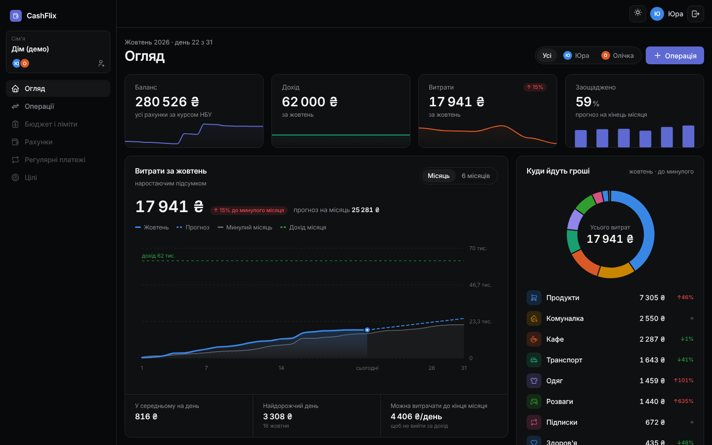
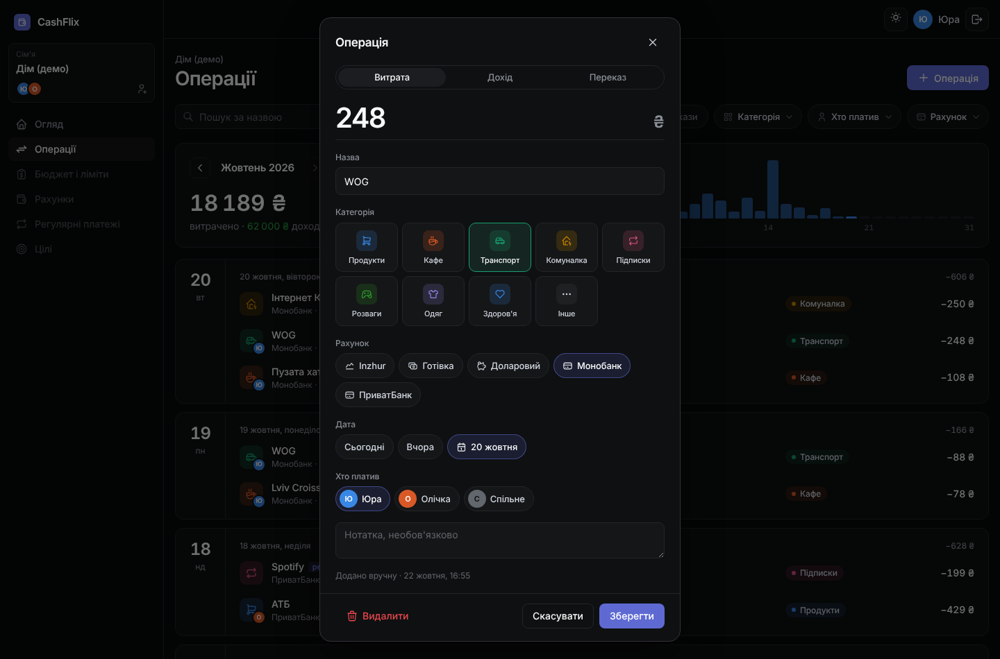
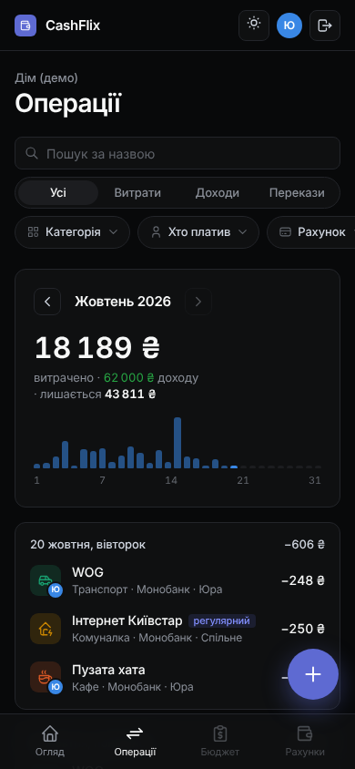

# CashFlix

Сімейний бюджет для кількох людей: витрати, доходи й перекази між рахунками в кількох валютах, ліміти на категорії (спільні й особисті), регулярні платежі та цілі накопичень. Вхід через Google, партнера можна запросити в сім'ю одноразовим посиланням. Оплати Apple Pay і Monobank потраплятимуть у бюджет автоматично.



| Картка операції | Телефон |
|---|---|
|  |  |

> Проєкт у розробці. Готово фази 0–3, далі — рахунки й курси НБУ.

## Можливості

- **Сім'я.** Спільний бюджет для кількох людей, запрошення за посиланням на 7 днів, видалення учасника без втрати його історії, перемикання між кількома сім'ями.
- **Операції.** Витрати, доходи й перекази. Пошук і фільтри без перезавантаження сторінки (HTMX), графік витрат по днях, клік по дню показує лише його операції.
- **Картка операції.** Додавання, редагування й видалення з можливістю «Повернути». Суму можна вводити з комою, валюта береться з рахунку, курс НБУ зберігається разом з операцією.
- **Огляд.** Баланс усіх рахунків, дохід і витрати з порівнянням до минулого місяця, прогноз витрат до кінця місяця, «Куди йдуть гроші», ліміти, останні операції, рахунки й цілі. Перемикач «Усі / окремий учасник».
- **Мультивалютність.** Кожна операція зберігає суму, курс на дату і суму в основній валюті, тож старі підсумки не змінюються.
- **Інтерфейс.** Українською через gettext, темна й світла тема, мобільна версія з нижнім меню.

## Стек

- Python 3.14, Django 5.2 LTS
- Django templates + django-cotton (компоненти), HTMX
- Tabler, Tabler Icons, ApexCharts
- django-allauth (вхід через Google)
- SQLite локально, PostgreSQL на проді
- pytest-django

Мінімум JavaScript: логіка на сервері, у HTMX-атрибутах і CSS (`:has()`). Власного JS — два невеликі файли (`app.js`, `charts.js`) і перемикач теми.

## Запуск локально (Windows / PowerShell)

```powershell
git clone https://github.com/GreedyClark/cashflix.git
cd cashflix
py -m venv .venv
.venv\Scripts\Activate.ps1
pip install -r requirements.txt
copy .env.example .env
```

У `.env` замініть `SECRET_KEY` на власний:

```powershell
python -c "from django.core.management.utils import get_random_secret_key; print(get_random_secret_key())"
```

Для входу потрібен OAuth-клієнт Google (Google Cloud Console → APIs & Services → Credentials). Redirect URI: `http://127.0.0.1:8000/accounts/google/login/callback/`. Його ID та секрет впишіть у `.env` як `GOOGLE_CLIENT_ID` і `GOOGLE_CLIENT_SECRET`.

```powershell
python manage.py migrate
python manage.py seed_demo
python manage.py runserver
```

`seed_demo` створює демо-сім'ю з операціями за пів року, лімітами й цілями. Сайт відкриється на http://127.0.0.1:8000.

## Тести

```powershell
pytest
```

## Що реалізовано

- [x] Фаза 0 — каркас: `.env`, українська мова з підтримкою перекладу, базовий шаблон, світла й темна тема, адаптивне меню
- [x] Фаза 1 — моделі: сім'ї, учасники, рахунки, категорії, операції з валютами, ліміти, регулярні платежі, цілі, демо-дані
- [x] Фаза 2 — вхід через Google, створення сім'ї, запрошення за посиланням, вихід і видалення учасників
- [x] Фаза 3 — сторінка операцій з фільтрами й графіком, картка операції, дашборд «Огляд»

## Що планується

- [ ] Фаза 4 — сторінка рахунків, перекази, автоматичний курс НБУ
- [ ] Фаза 5 — налаштування лімітів, регулярні платежі, підказки, цілі, експорт в Excel
- [ ] Фаза 6 — iOS-шорткат для будь-якого банку, Monobank API з автоматичними категоріями, захист від дублів, перенесення старих даних
- [ ] Фаза 7 — деплой
- [ ] Фаза 8 — AI-асистент на ключі Gemini користувача
