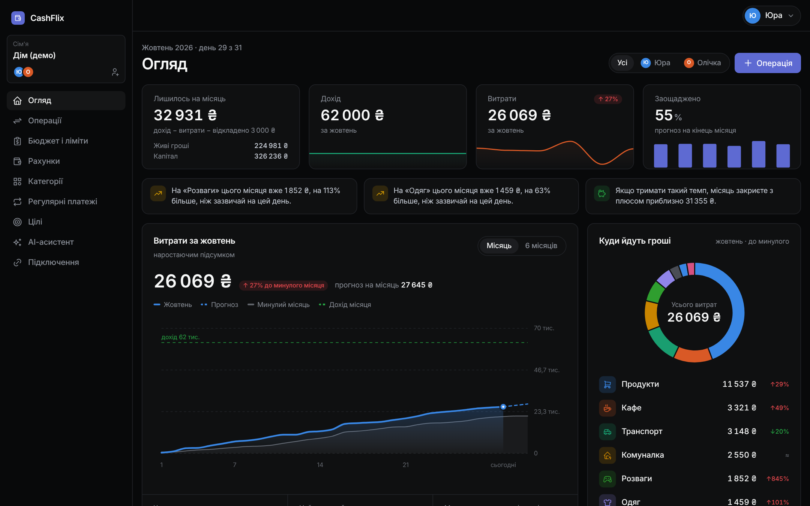
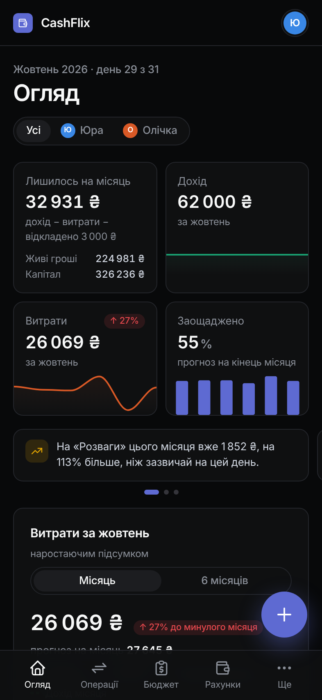
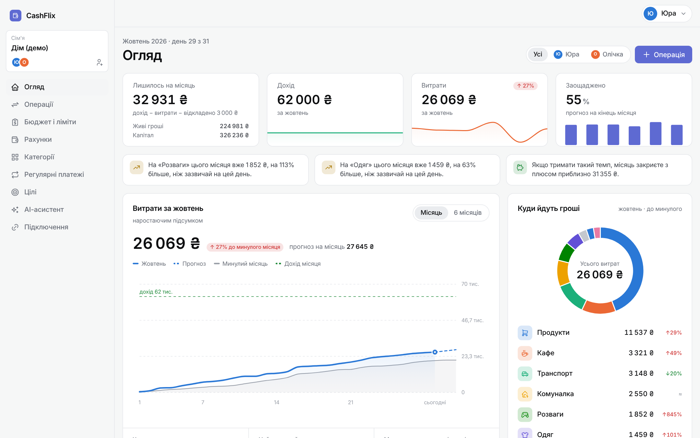
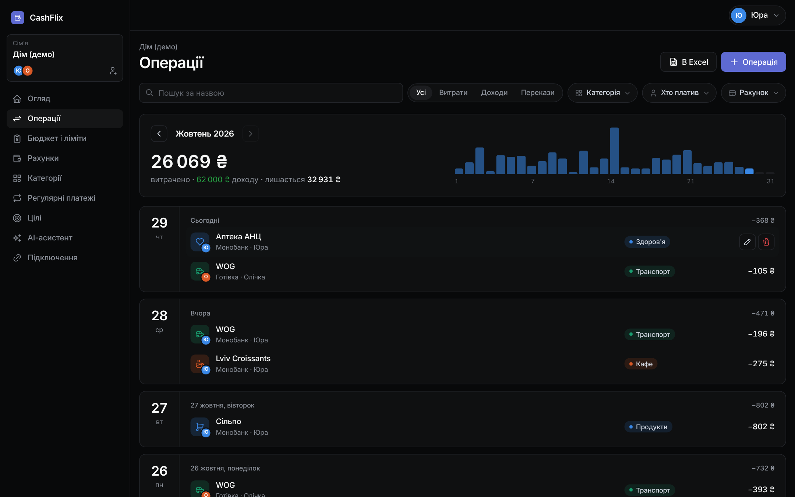
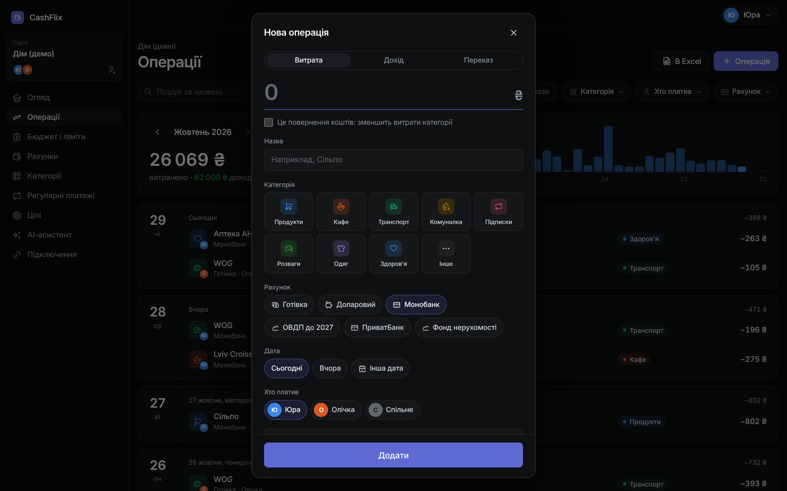
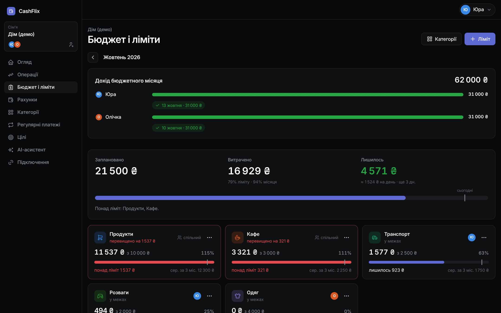
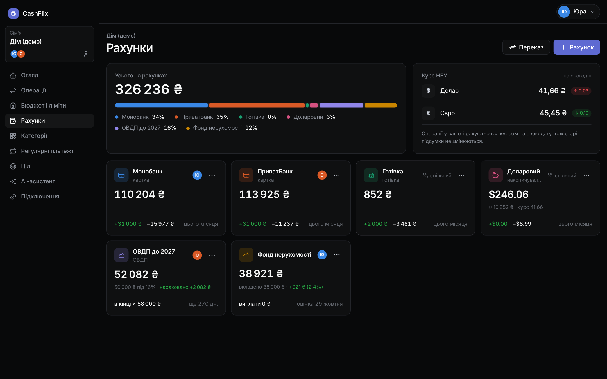
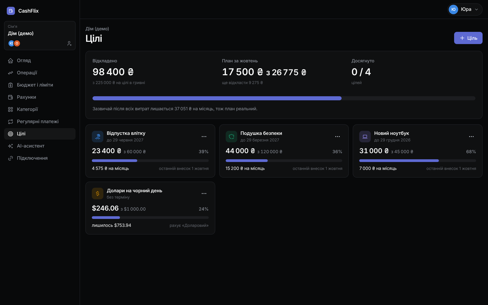
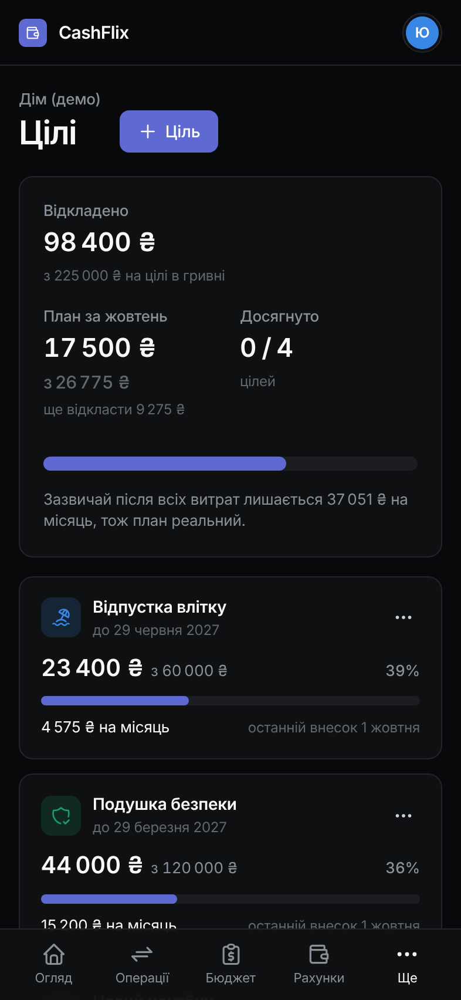
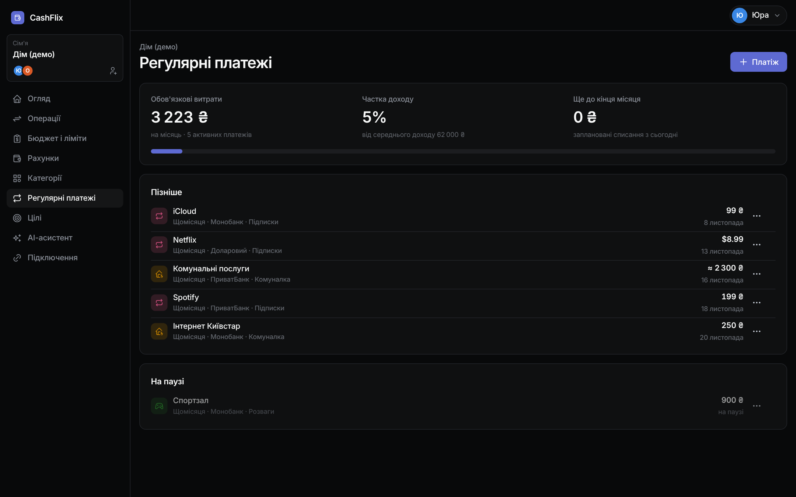

# CashFlix

A family budget app for two or more people. You and your partner log expenses, income and transfers across cards, cash, savings and investments in several currencies. CashFlix tracks category limits, recurring payments and savings goals, and tells you how much money you have left for the month.

Live demo: https://cashflix-m5vd.onrender.com (press **«Увійти в демо як Юра»** on the login page; the free server takes up to a minute to wake up).

The interface is in Ukrainian.



| Phone | Light theme |
|---|---|
|  |  |

## Features

**Family budget.** One shared budget for the whole family. You invite a partner with a one-time link that lasts 7 days. Each account, limit and operation belongs to one person or to the family, and a switch on the overview shows everyone or one member.

**Overview.** The first tile shows what is left this month: income minus expenses minus money moved to savings. Below it you see live money (cards and cash), total capital, a spending forecast that counts unpaid recurring bills, limits with a pace marker, upcoming payments and short insights such as "Clothes is 63% above your usual pace".



**Operations.** Expenses, income and transfers with search, filters and a daily chart. HTMX reloads the list without a page refresh. A checkbox marks an expense as a refund, so it lowers the category total instead of counting as income. Export goes to Excel.



**Budget month and limits.** Your budget month can start on payday (for example the 20th). A limit is a fixed amount or a percent of the month's income, shared or personal. CashFlix compares spending with the average of the last three months.



**Accounts and currencies.** Cards, cash, savings and investment accounts in UAH, USD or EUR. Each operation stores the National Bank of Ukraine rate for its date, so old totals stay the same when the rate moves. Investment accounts handle fixed-rate deposits and bonds (interest accrues daily) or market value updates.



**Savings goals.** A goal has a target, an optional deadline or monthly amount, and its own currency. When you put money aside from a card, CashFlix records a transfer to the goal's account or to a reserve account, so the money leaves your spendable balance. The goals page shows this month's plan and warns you if the plan is larger than what you usually have left.

| Goals | Phone |
|---|---|
|  |  |

**Recurring payments.** Subscriptions and bills with automatic or manual payment, reminders by web push or Telegram at an hour each person picks.



**Bank imports.**
- Monobank API: card statements arrive through a webhook. CashFlix subtracts the credit limit from the balance, turns ATM withdrawals into transfers to cash, recognizes refunds and cashback, and merges both halves of a transfer between your own cards.
- iOS Shortcut: an Apple Pay payment from any bank lands in the budget through a personal token.

**Security.** Google sign-in. Two-factor confirmation through Telegram or an authenticator app, with backup codes. Bank tokens and API keys stay encrypted in the database (Fernet).

**AI assistant.** Each family adds its own free Gemini key. The assistant receives category totals only, without shop names or account names.

**PWA.** You can install CashFlix on a phone home screen and get push notifications.

## Stack

- Python 3.13, Django 5.2
- Django templates, django-cotton components, HTMX 2
- Tabler, Tabler Icons, ApexCharts
- django-allauth (Google), pywebpush, google-genai
- SQLite locally, PostgreSQL (Neon) in production
- pytest-django, around 360 tests

The server renders the pages. Custom JavaScript is limited to a few small files for charts, the theme switch and push subscription.

## Run locally

Requirements: Python 3.13 and Git. On Windows, in PowerShell:

```powershell
git clone https://github.com/GreedyClark/cashflix.git
cd cashflix
py -3.13 -m venv .venv
.venv\Scripts\Activate.ps1
pip install -r requirements.txt
copy .env.example .env
```

Fill in `.env`. Generate the two keys with:

```powershell
python -c "from django.core.management.utils import get_random_secret_key; print(get_random_secret_key())"
python -c "from cryptography.fernet import Fernet; print(Fernet.generate_key().decode())"
```

The first value goes to `SECRET_KEY`, the second to `ENCRYPTION_KEY`. Then:

```powershell
python manage.py migrate
python manage.py seed_demo
python manage.py runserver
```

Open http://127.0.0.1:8000 and press **«Увійти в демо як Юра»**. `seed_demo` creates a family with six months of operations, limits, recurring payments and goals.

Optional settings in `.env`:

| Variable | Needed for |
|---|---|
| `GOOGLE_CLIENT_ID`, `GOOGLE_CLIENT_SECRET` | Google sign-in. Redirect URI: `http://127.0.0.1:8000/accounts/google/login/callback/` |
| `TELEGRAM_BOT_TOKEN` | Telegram confirmation and reminders |
| `VAPID_PUBLIC_KEY`, `VAPID_PRIVATE_KEY` | Web push. Generate with `python manage.py vapid_keys` |
| `CRON_SECRET` | The daily job URL `/tasks/daily/<secret>/` (NBU rates, recurring payments, reminders) |

## Tests

```powershell
pytest
```

## Deployment

The demo runs on Render (free web service) with a Neon PostgreSQL database. cron-job.org calls `/tasks/daily/<CRON_SECRET>/` to load exchange rates, create due recurring payments and send reminders. All secrets live in Render environment variables.
